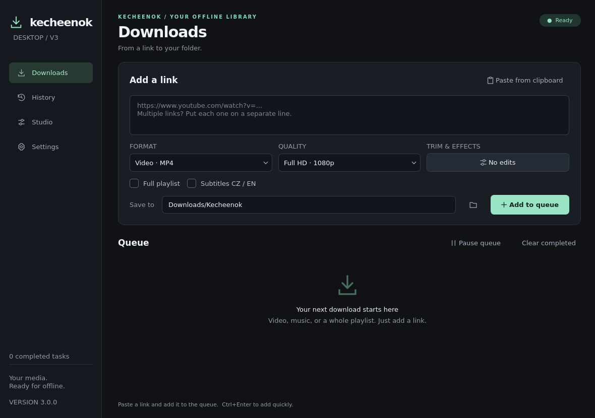

# Kecheenok v3

<p align="center">
  <strong>Video and audio downloader for Windows, Linux, and macOS</strong><br>
  A desktop app with a download queue, history, and a simple media studio.
</p>



**Source project v3.0.0.** The included build script or GitHub Actions can create a Windows package. Running it on Windows has not yet been verified. See [Download troubleshooting](#download-troubleshooting) for the current YouTube download status.

[Run from source](#quick-start-from-source) · [Windows package](#build-the-windows-package) · [Upload to GitHub](#publish-on-github) · [Build with Actions](#get-the-windows-zip-through-github-actions)

## Features

- Queue multiple links with progress, speed, and time estimates. Cancel or retry tasks.
- Video in MP4/MKV up to 4K and audio in MP3/M4A/FLAC/WAV.
- Individual videos and playlists, with an item limit.
- Optional Czech and English subtitles as SRT files.
- History, search, and quick access to a downloaded file or its folder.
- Studio for trimming and audio editing; exports changes to a new copy and keeps the original.
- Saved settings, startup diagnostics, and yt-dlp updates on Windows, Linux, and macOS.

Pausing the queue lets the running task finish. MP4 describes a container, not a guaranteed codec; Studio can export video as H.264/AAC. FLAC and WAV cannot restore quality that was not present in the source.

## Quick start from source

Python 3.13 is required; a 64-bit installation is recommended. Internet access is needed to install the Python packages. On Windows, `run.bat` also downloads the helper tools. On Linux/macOS, install FFmpeg, FFprobe, and Deno or Node.js with your system package manager before launching the app; yt-dlp is installed with the Python requirements.

**Windows:** Run `run.bat`. If `py -3.13` does not work, install 64-bit Python 3.13 from [python.org](https://www.python.org/downloads/).

**Linux/macOS:**

```sh
python3.13 -m venv .venv
.venv/bin/python -m pip install -r requirements.txt
.venv/bin/python KecheenokV3.py
```

When running outside Windows, FFmpeg, FFprobe, and Deno or Node.js must be available in `PATH`. For Linux development, you can use system-installed PyQt6; the Windows build uses PySide6.

## Build the Windows package

Build the Windows app on Windows. PyInstaller is not a cross-compiler: it builds an app for the system where it runs ([PyInstaller documentation](https://pyinstaller.org/en/stable/)).

1. On Windows 10/11 x64, install standard 64-bit Python 3.13 from [python.org](https://www.python.org/downloads/). Keep the Python Launcher (`py`) selected during installation.
2. Download or clone the repository and open its root folder, where `build_windows.bat` is located.
3. Run `build_windows.bat` and wait for it to finish. The first build needs internet access and downloads libraries, yt-dlp, Deno, and FFmpeg; downloading FFmpeg may take longer.
4. The finished archive will be at `dist/Kecheenok-v3.0.0-windows-x64.zip`, with a `.sha256` checksum beside it.
5. Extract the entire ZIP and run `Kecheenok/Kecheenok.exe`. Keep the `_internal` folder beside the EXE. You do not need to install Python, FFmpeg, or Deno separately on the target Windows computer.

The build checks the Windows PE header and runs the actual built app with `--self-test`. The results and tool versions are saved in `startup-test.json` and `build-manifest.json` inside the package. If the tools have already been downloaded and verified, you can rebuild without downloading them again:

```bat
.venv-build\Scripts\python.exe scripts\build_windows.py --reuse-tools
```

## Publish on GitHub

These steps assume the `v3` folder will be the repository root. Add the **contents** of this folder to Git (`README.md`, `.github`, `KecheenokV3.py`, etc.), not the parent `Kecheenok releases` folder.

1. Sign in at [github.com](https://github.com/) and select **New repository**.
2. Name it `Kecheenok`, choose public or private, and create it **empty**: do not select options to add a README, license, or `.gitignore`.
3. Open a terminal in the `v3` folder. In Windows File Explorer, open the folder, right-click, and select **Open in Terminal**.
   On this Linux computer, navigate to the project with:

   ```sh
   cd "/home/kxnvra/EVERYTHING FROM THE MICRO USB/Kecheenok releases/v3"
   ```

4. If this folder is not already a Git repository, run these commands. Replace `YOUR-GITHUB-USERNAME` with your GitHub username:

   ```sh
   git init -b main
   git add .
   git status --short
   git commit -m "Kecheenok v3: new design and Windows build"
   git remote add origin https://github.com/YOUR-GITHUB-USERNAME/Kecheenok.git
   git push -u origin main
   ```

   For example, the account `jan-novak` uses the address `https://github.com/jan-novak/Kecheenok.git`. These commands follow [GitHub's guide for adding locally hosted code](https://docs.github.com/en/migrations/importing-source-code/using-the-command-line-to-import-source-code/adding-locally-hosted-code-to-github).

   If Git authentication is not set up yet, you can use [GitHub CLI](https://cli.github.com/): run `gh auth login`, then choose GitHub.com → HTTPS → sign in with a browser. Then repeat `git push -u origin main`. Direct HTTPS authentication with Git uses an access token, not your account password.

   If a commit reports that your name or email is missing, set them for this project and retry the commit:

   ```sh
   git config user.name "Your name"
   git config user.email "Your GitHub email or noreply address"
   ```

   If Git says that `origin` already exists, update its address and then retry the push:

   ```sh
   git remote set-url origin https://github.com/YOUR-GITHUB-USERNAME/Kecheenok.git
   git push -u origin main
   ```

The **Windows v3** workflow runs for pull requests and when you push a `v3.*` tag. After your first regular push to `main`, start it manually as described below.

## Get the Windows ZIP through GitHub Actions

The `.github/workflows/windows.yml` workflow builds and tests the app on a Windows runner, then saves the ZIP and its SHA-256 checksum as an Actions artifact. Start the first build manually:

1. In the GitHub repository, open **Actions** and select **Windows v3** on the left.
2. Click **Run workflow**, leave the branch set to `main`, and confirm with **Run workflow**.
3. Open the new run. When it finishes successfully, find the `Kecheenok-v3-windows-x64` artifact under **Artifacts**.
4. Download and extract the artifact ZIP. It contains `Kecheenok-v3.0.0-windows-x64.zip`, the checksum, and a test report.

GitHub artifacts are for reviewing and downloading a specific run; their availability is limited according to the repository settings. To publish the Windows ZIP, attach it as a file to a **Release**. Guides: [manually running a workflow](https://docs.github.com/en/actions/how-tos/manage-workflow-runs/manually-run-a-workflow) and [downloading an artifact](https://docs.github.com/en/actions/how-tos/manage-workflow-runs/download-workflow-artifacts).

To start a build for the current version with a tag:

```sh
git tag v3.0.0
git push origin v3.0.0
```

For the next release, first change the version number in `kecheenok/__init__.py`, commit and push the change, then push the matching new tag. The tag starts a build; create a GitHub Release separately to make the download public.

## Download troubleshooting

An **HTTP 403 Forbidden** error was reported for a specific video. A fix for that case has not yet been verified directly against YouTube. The app can now update yt-dlp to the recommended nightly version on all supported systems.

1. Restart the app so it loads the current code.
2. Open **Settings → Repair / update tools**. Wait for it to finish successfully; the update needs internet access.
3. Retry the task. If it still fails, save the diagnostics and check the yt-dlp version and whether Deno is available.

The nightly version includes newer fixes for YouTube changes: [yt-dlp's official recommendation](https://github.com/yt-dlp/yt-dlp#update). The update downloads the official binary, verifies its SHA-256 checksum, and saves it in the app's user folder. On Linux/macOS, system package managers handle FFmpeg and Deno.

**HTTP 429 Too Many Requests** means the server is limiting requests. Wait, then retry the task. Subtitles download after the video; if they fail, the app shows a warning and keeps the downloaded video.

If the problem continues, save the diagnostic log from the app and include it in a report along with the app version, operating system, and error type. Review the log and remove personal information before sharing it. Never share cookies or add them to Git.

## Verification and limitations

You can run tests and GUI diagnostics locally without accessing YouTube:

```sh
python3 -m unittest discover -s tests -v
QT_QPA_PLATFORM=offscreen python3 KecheenokV3.py --self-test --report test-output/source-self-test.json
```

Checks include offline media handling and a local test source. Some network tests may be skipped when the environment blocks network access. In this environment, the source was checked on Linux; that does not prove the Windows package works or that YouTube is currently available. The Windows artifact is prepared by the workflow; no EXE is included here or has already been verified in this environment.

## Data and privacy

Settings, history, and logs are stored in `%LOCALAPPDATA%\Kecheenok` on Windows, `~/.local/share/Kecheenok` on Linux, and `~/Library/Application Support/Kecheenok` on macOS. The default download folder is the system's Downloads/Kecheenok folder. An optional cookies file can provide access to content that requires sign-in; history stores only the file path.

`.gitignore` excludes environments, builds, downloaded tools, test output, logs, and commonly named cookie files. Still check that you are not adding personal cookies or other secrets before running `git add .`. Licenses for included tools are listed in [THIRD_PARTY_NOTICES.txt](THIRD_PARTY_NOTICES.txt).
